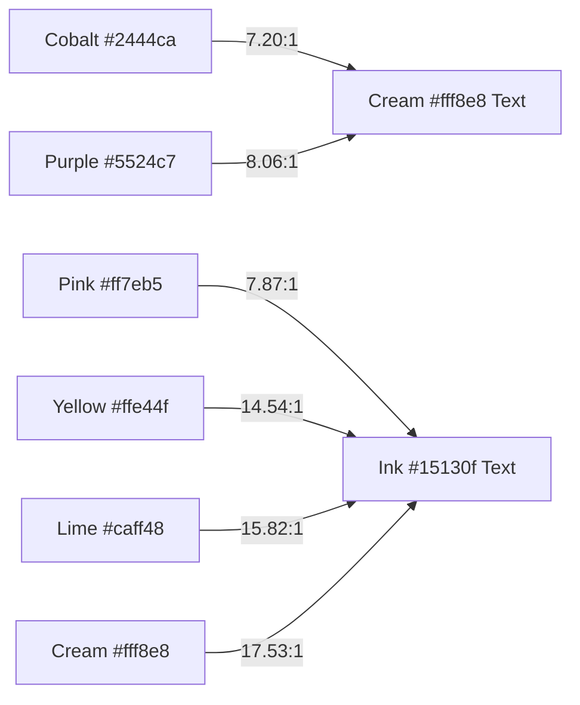

# 03.02 — Color Palette, Design Tokens, and Overlays

Status: Current  
Last Updated: 2026-11-06

---

Site Design exposes Primary, Secondary, Button, Accent, Additional Colour 1–3, Background, Raised Surface and Text, plus Button Text, Primary Surface Text, Success and Error. These controls retain their identity when their hex values change. The complete role mapping and saved-palette compatibility rules are maintained in the root `DESIGN_SYSTEM.md`.

Shared hover and pressed states derive from their base roles through `src/styles/ui-colors.css`. The Colours tab publishes and restores colour values separately from numeric design settings. The database, art-directed lab experiments and archived editions can own independent palettes.

The original edition names below describe the current colour values and contrast examples. Use role variables when implementing shared components.

## 1. Canonical Colour Roles

The visual palette is defined by role-based CSS custom properties:

```css
:root {
  --color-primary:   #2444ca; /* Cobalt */
  --color-secondary:   #ff7eb5; /* Hot Pink */
  --color-button: #ffe44f; /* Acid Yellow */
  --color-accent:   #caff48; /* High-Chroma Lime */
  --color-additional-1: #ff875c; /* Warm Orange */
  --color-additional-2: #5524c7; /* Deep Violet */
  --color-additional-3:   #62e6ff; /* Electric Cyan */
  --color-background:  #fff8e8; /* Warm Paper Cream */
  --color-text:    #15130f; /* Near-Black Ink */
  --pop-border: rgba(21, 19, 15, 0.78); /* High-contrast Keyline */
  --pop-line:   rgba(21, 19, 15, 0.24); /* Subtle Divider */
}
```

---

## 2. WCAG Contrast and Pairing Matrix

To maintain accessible readability, foreground colors are paired strictly according to contrast thresholds:



### Contrast Invariants:
- **Forbidden**: Never place `--color-text` text on `--color-primary` (2.43:1) or `--color-additional-2` (2.18:1).
- **Forbidden**: Never place `--color-background` text on `--color-secondary`, `--color-button`, or `--color-accent`.

---

## 3. Grain Texture and Overlays

To evoke the tactile grain of 35mm film and risograph print:
- A subtle SVG noise filter (`src/styles/grain.css`) is composited over the body background:
  ```css
  .grain-overlay {
    position: fixed;
    top: 0; left: 0; width: 100vw; height: 100vh;
    pointer-events: none;
    z-index: 9999;
    opacity: 0.035;
    background-image: url("data:image/svg+xml,...");
  }
  ```
- **Performance Invariant**: Uses hardware-accelerated static SVG noise with `pointer-events: none` to ensure zero impact on scroll framerates.
