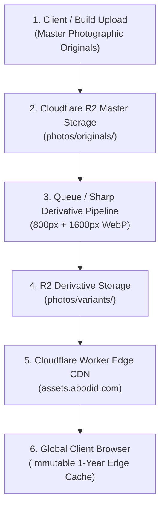

# 06.02 — Cloudflare R2 Media Library and Image Delivery

Status: Current  
Last Updated: 2026-10-02  

---

## 1. Storage Architecture

All media assets (photography, video loops, PDFs, moodboard assets) are stored in **Cloudflare R2** under the canonical bucket `assets`:



---

## 2. Directory Taxonomy

- `photos/originals/<series>/`: Master photographic originals (JPEG, PNG, WebP, GIF, and AVIF).
- `photos/originals/moodboard/`: Canonical destination for Chrome, Finder, and admin moodboard capture.
- `photos/variants/<series>/800/`: WebP assets used by grid and thumbnail views.
- `photos/variants/<series>/1600/`: WebP assets used by opened viewers and larger layouts.
- `assets/audio/`: Audio voiceovers and ambient soundscapes.
- `assets/videos/`: H.264 / WebM looped preview clips.

---

## 3. Delivery and Optimization Standards

- **Edge Worker CDN**: Public URLs resolve via `https://assets.abodid.com/...`.
- **Immutable Caching**: All R2 media responses declare:
  ```http
  Cache-Control: public, max-age=31536000, immutable
  ```
- **Presigned Uploads**: Direct browser-to-R2 uploads are authenticated via presigned S3 URLs generated by `src/lib/media/r2.ts` with 5-minute expirations.
- **Animation-aware output**: GIF originals remain untouched; responsive copies are encoded as animated WebP. Quality adapts to source size and frame count, and the backfill verifies that animation frames survived before publishing a variant record.
- **No enlargement**: An original narrower than 800px or 1600px is recompressed into both stable variant locations without being scaled up.
- **Repair command**: `npm run backfill:moodboard-variants -- --dry-run` audits the moodboard folder. Remove `--dry-run` to catalogue missing originals and generate or repair both sizes.

## 4. Moodboard Cache Split

- The `/moodboard` document stays static to protect Vercel CPU usage. Current tags are loaded once from the public Supabase Storage `moodboard-search/search-v1.json` file, published only after relevant database changes. Its 60-second cache is separate from image caching. See [search publication](../../../moodboard-search-publication.md).
- Fingerprinted R2 variants use a one-year immutable cache. A source change creates a new fingerprinted URL instead of trying to purge a global CDN object.
- The grid requests the 800px URL; the opened viewer requests 1600px. Either path falls back to the original while processing is incomplete.
- Supabase stores catalogue data and relationships only. Image bodies travel directly from Chrome or macOS to R2 and from the R2 edge to the visitor.

### Media Library uploads and downloads (4 November 2026)

- The admin Media Library file picker and drop area accept multiple files in any format. Unknown browser MIME types use `application/octet-stream`.
- File bodies go directly to R2: `/api/admin/media/presign` prepares an upload, the browser performs the signed PUT, and `/api/admin/media/complete` verifies actual R2 size/type and saves catalogue metadata. This avoids Vercel's 4.5 MB upload-body ceiling. The legacy `/upload` endpoint remains for existing callers, and is still subject to that platform ceiling.
- The shared upload policy permits images up to 20 MiB each and all other files up to 100 MiB each. Failed batch entries do not prevent later files from uploading; the interface reports successes and failures separately.
- Native checkboxes in grid and list views support individual selection, select-all-shown, and clearing. Selection persists across folders and searches; preview selection is independent.
- **Download selected (ZIP)** fetches selected originals sequentially through the admin-authenticated `/api/admin/media/download` streaming endpoint. The current bucket CORS policy permits browser PUT but does not return browser GET CORS headers, so the same-origin stream is needed for ZIP creation. R2 response bytes are streamed without server-side buffering.
- ZIP generation is lazy-loaded in the browser; original bytes and extensions are preserved, unsafe filename paths are stripped, and duplicate names receive numbered suffixes. The completed ZIP is held in browser memory until saving. ZIP32 archives approaching 4 GiB are rejected visibly; use smaller selections for very large downloads.

### Folder organization and the library clipboard (4 November 2026)

- Drag a file onto a visible subfolder, sidebar folder, or breadcrumb to move it. Dragging a checked file moves the complete checked selection. Computer files dropped on a folder upload directly into that folder; internal drags never enter the upload path.
- Moves update the nullable `media_assets.library_folder_path` override. `NULL` follows the physical storage folder; an empty string means library root. R2 keys, public URLs, variants, project relationships, and manual metadata stay unchanged. This is library organization, not a rename of the underlying Cloudflare object key. The processor can continue updating storage metadata without undoing a library move.
- The folder and search endpoints combine physical R2 listings with the folder overrides, so a moved file appears in its destination and disappears from its source. Search match counts and location labels use the library location.
- **Copy files**, **Cut**, and **Paste here** are available in the toolbar, multi-file inspector, and custom context menu. `Ctrl/Cmd+C`, `Ctrl/Cmd+X`, and `Ctrl/Cmd+V` operate inside the library when the user is not editing text. The library clipboard lasts for the current mounted session; it is separate from the system clipboard and **Copy link**.
- Pasting copied files performs server-side R2 copies into new unique keys and creates separate catalogue entries with the original display filenames. Pasting cut files moves the existing catalogue locations. Destination names never overwrite an existing object. Each request handles at most 100 files with four concurrent operations; larger UI selections are sent in batches. Failures are reported per file; successful cut entries leave the clipboard.
- Right-click a folder to paste directly into it, or right-click empty space to paste into the open folder. A visible Actions button provides the same menu for touch. The menu supports arrow keys, Home/End, Escape, light dismiss, focus restoration, and Shift+F10. Native Popover and CSS anchor positioning are feature detected, with fixed placement and keyboard fallbacks.
- Apply `20261104063204_media_library_folder_locations.sql` before deploying the new folder/search endpoints. The additive migration was applied and verified on the connected database; it does not move existing files.

### Copying and cutting folders (4 November 2026)

- Right-click a folder card or sidebar folder to **Copy folder** or **Cut folder**; keyboard users can press Shift+F10 on a folder. The toolbar and inspector expose the same commands. Paste operates on one folder tree at a time and retains nested files and empty subfolders. Folder cards can also be dragged onto folders, sidebar locations, or breadcrumbs.
- `/api/admin/media/folder-organize` first plans the visible logical tree, allocates an available destination name (`name`, `name-2`, etc.), and creates destination folder markers. The browser processes files through the existing authenticated organize endpoint in batches of at most 100. Planning refuses truncated listings, trees beyond 500 folders/5,000 files, paths beyond the existing depth limit, and plans larger than 4 MiB.
- Copy duplicates file bytes into fresh R2 keys. Cut updates file library locations, preserving original public keys. After every file has moved, a finish request rescans the source and refuses to hide it while any files remain. Partial failures keep the source visible and report the error; already completed file operations remain at their destinations.
- `media_library_hidden_folders` suppresses completed source folders from library navigation while keeping their physical R2 objects available to existing links. Every source subfolder receives a suppression entry. The table uses RLS and the existing admin-only policy function. Creating a folder explicitly at a suppressed path restores that folder in the library. Future external writes to an old physical prefix are not automatically redirected; use the current library destination for new uploads.
- Apply `20261104064948_media_library_hidden_folders.sql` before these endpoints are deployed. This migration and `20261104065753_protect_media_library_folder_anonymous_access.sql` have been applied; RLS requires a permanent admin account. Existing user folders have not been moved by either migration.

### Minimum Media Library interface (4 November 2026)

- The interface follows the approved reference with warm paper surroundings, white panels, cobalt selection accents, compact folder tiles, consistent image previews, and a lazy expandable folder tree. It retains **Folders**, **New folder**, and **Upload**; there are no Collections, storage quotas, recent-upload widgets, tagging controls, or Delete controls.
- **All files** uses `/api/admin/media?view=all` to browse original assets across the bucket, including uncatalogued files. R2 listings are cached per endpoint/bucket for five minutes; the complete merged index is cached for one minute. Explicit Refresh and library writes invalidate the relevant cache; ordinary navigation reuses it. Generated `photos/variants/` and `variants/` renditions remain available in folder browsing and as previews, rather than appearing as duplicate originals in All files.
- Global browsing filters and sorts the full visible snapshot before returning pages of 120 files. **Load more files** appends the next page without losing selection; **Select all shown** selects only loaded, matching files. Counts come from actual objects. Storage scans retain the existing 25,000-object safety bound and disclose truncation; directory browsing keeps its existing item limits. A read-only live verification found 3,769 original files across eight top-level folders without truncation; the catalogue contained 3,710 records at that time.
- Search is scoped to the open folder and its subfolders, or the whole library from All files. There is one Type filter (images, videos, documents, audio, other), one sort control, and grid/list views. Folder-tree expansion and the Move picker request folder names without transferring the file catalogue.
- Copy/Cut/Move/Download actions appear when an item is selected. Paste remains available while the library clipboard contains items. The details panel opens on selection and can be closed without clearing the selection. Small layouts stack details and expose a folder-navigation toggle.
- The native **Move to folder** dialog supports files or a folder tree, retains drag-and-drop as an alternative, and prevents moving a folder into itself. New-folder and Rename dialogs also use native `showModal()` focus management.
- File Rename writes `media_assets.library_filename`, a separate display-name override that survives asynchronous processor updates. The R2 key, public URL, relationships, captions and tags stay unchanged. Copies preserve the display name in the override. Folder Rename uses the existing planned folder move flow in the same parent and rejects a name collision.
- `/api/admin/media/metadata` accepts only a validated display name and/or image alt text after admin authorization. Existing catalogue records are registered with ignore-duplicates semantics before a narrowly scoped update; it does not replace arbitrary metadata. Failed saves retain editable text. Manual artistic tags and the Master Tag Builder are untouched.
- Apply `20261104090001_media_library_display_names.sql` before deploying these changes. The additive column is applied on the connected database. No existing assets were renamed or moved during verification. UI and API source changes have not been deployed by this task.


### Library loading and caching (4 November 2026)

- All-files storage scanning first lists root prefixes, then reads up to four branches concurrently. It excludes `variants/` and `photos/variants/` before fetching their object listings, retains root-level originals, legacy uncatalogued objects, empty root folders and continuation-token pagination, and discloses the 25,000-original safety bound. A failed branch fails the scan instead of caching an incomplete result.
- The server caches R2 inventory for five minutes and the merged catalogue/visibility index for one minute, keyed by endpoint and bucket. Sorting, searching and pagination share the merged index. Cold inventory, catalogue and visibility reads run concurrently; folder metadata batches use bounded concurrency. Authorization still runs before every API response, which retains `Cache-Control: no-store`. The caches are bounded process memory; serverless cold instances still need a network scan.
- The browser keeps up to 24 listings for one minute in component memory, scoped to the current access token. Back-navigation can paint a retained listing immediately and revalidate expired data. Concurrent requests share an in-flight promise; navigation guards against late responses. Cache invalidation prevents an older request from restoring a listing after an edit. No private listings or credentials are persisted in local storage or a service worker.
- Hovering or keyboard-focusing a folder for 180 ms prefetches its first listing at low fetch priority. Only one speculative request runs at a time, and prefetching is skipped on Save-Data/2G connections. Folder type and sort changes reuse the complete local listing. Mutations clear browser listings and mark All files for a server refresh, including when the next read lands on a different server instance. Metadata edits refresh catalogue data without repeating an unchanged storage scan. Explicit Refresh forces a fresh inventory. Other clients/instances can retain their snapshot until its TTL or manual refresh.
- Initial image cards load eagerly, below-fold cards retain native lazy loading, and the inspector uses the 1600px rendition when available. Full originals remain available through Open/Download. Existing HTTP image caching is retained; original PDFs/videos are fetched when requested rather than preloaded in bulk.
- Read-only local timings against the connected storage/catalogue (3,771 originals, no truncation): cold listing processing decreased from 16,590 ms to 7,349 ms; next-page processing from 1,321 ms to 11 ms; document-filter processing from 1,055 ms to 1 ms. These are individual observations excluding authorization, HTTP travel, browser rendering and image/file transfer; they are not production latency guarantees. No user files were moved or renamed for benchmarking. Source changes require deployment.
